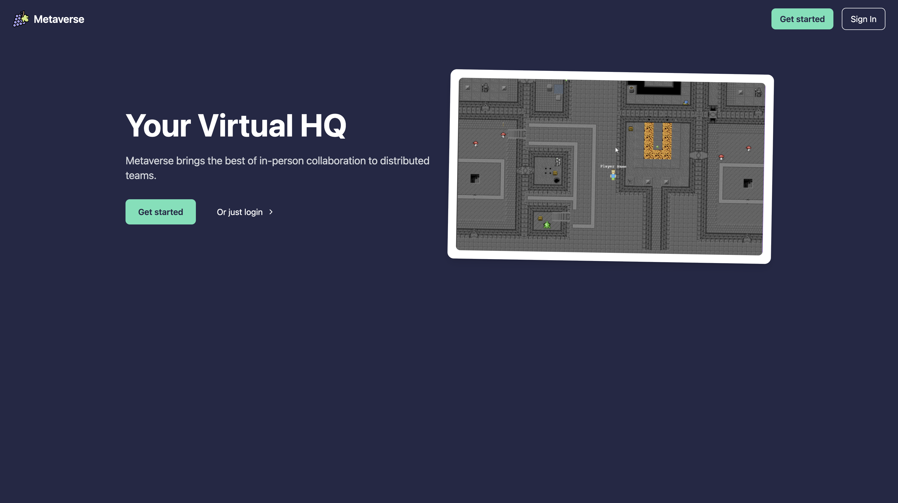
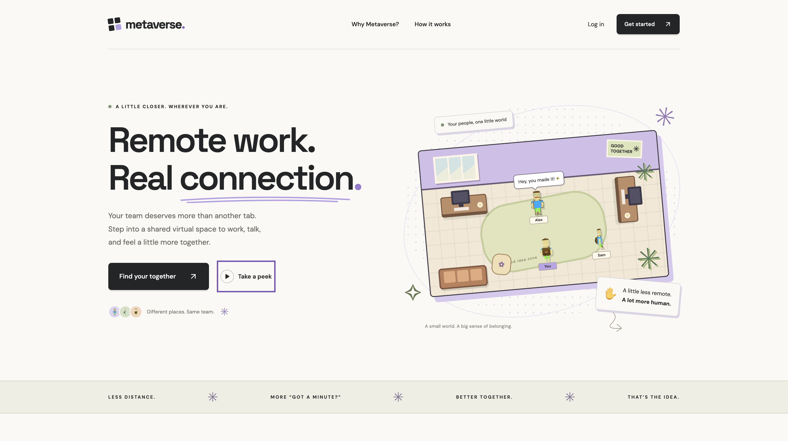

# Reforge

An agent skill for redesigning landing pages and mobile onboarding while keeping the brand recognizable.

Reforge guides your coding agent through a short audit, implementation, and verification. It focuses on typography, hierarchy, composition, image framing, and clearer actions while preserving existing colors, fonts, imagery, and voice.

## Before and after

A Metaverse landing-page redesign, shown before and after. This example changes the logo, palette, theme, and product imagery. Changes of this scope require explicit rebranding and asset-replacement authorization; Reforge preserves existing brand identity and imagery by default.

### Before



### After



## Install

Run this from the project where you want to use Reforge:

```bash
npx skills add gurshaan17/reforge --skill reforge
```

The installer lets you choose your coding agents. For installation across projects, add `-g`:

```bash
npx skills add gurshaan17/reforge --skill reforge -g
```

To inspect the available skills before installing:

```bash
npx skills add gurshaan17/reforge --list
```

Use a current Node.js installation that meets the [skills CLI requirements](https://github.com/vercel-labs/skills). See the [skills.sh documentation](https://skills.sh/docs) for installer details and supported agents. No npm package, API key, or separate Reforge service is required; your agent supplies the implementation and inspection tools.

## Use

Open your project in your coding agent, type `/reforge`, and describe the page or flow to improve. If your harness uses a different skill invocation syntax, use its equivalent.

### Redesign a landing page

```text
/reforge audit and redesign the landing page in src/app/page.tsx.
Our audience is independent designers, and the primary action is starting
a free trial. Keep our existing palette, fonts, logo, and product screenshots.
Implement the changes and check desktop and mobile layouts.
```

### Polish an existing page

```text
/reforge improve the pricing page's typography, spacing, and hierarchy.
Preserve the pricing, content, images, and checkout behavior. Keep the scope
to this page and use the existing components.
```

### Improve mobile onboarding

```text
/reforge improve our mobile onboarding screens. The first useful
outcome is creating a workspace. Preserve navigation and business logic,
clarify each step, and check keyboard behavior and permission-denial states.
```

### Request a critique

```text
/reforge critique this landing page screenshot. Identify the highest
impact improvements to message, hierarchy, typography, and composition.
Provide recommendations only.
```

For better results, provide the target route, files, URL, or screenshots; the intended audience; the main action; and any implementation constraints. If your agent cannot access a URL or render the app, provide the relevant source or screenshots. The skill asks for a target when none can be found.

## What the skill does

1. **Establish direction.** Inspect the page and project constraints, identify strengths and weaknesses, and choose a direction grounded in the existing brand.
2. **Capture the baseline.** Record the palette, theme, fonts, logo, voice, and visible imagery. Capture comparable before screenshots when rendering tools are available.
3. **Implement improvements.** Prioritize typography, spacing, hierarchy, and image framing. Carry the treatment through lower sections, forms, interaction states, and mobile layouts within scope.
4. **Verify the result.** Inspect the full page or onboarding path where tools permit, check relevant interactions and project checks, and compare the result with the baseline.
5. **Deliver.** Explain the changes, rationale, verification, and any limitations. Provide comparable before-and-after views when screenshots are available.

The included references cover content-led composition and responsive reading order, selection and fallback guidance for 22 background treatments, and onboarding flow analysis including progress, permissions, saved state, recovery, and keyboard behavior. They are loaded when relevant. The initial audit sets observable improvement targets; the final review checks those targets against rendered output and revisits specific unresolved issues.

## Scope and expectations

- Existing brand identity and imagery are preserved unless you explicitly authorize changes. A request to modernize a page does not authorize a rebrand.
- The agent works in the project's existing stack and reuses components where appropriate. Reforge does not require a particular framework, browser plugin, or image generator.
- Critique requests produce a critique; implementation requests produce working changes. Alternative directions are available when requested.
- Testimonials, metrics, pricing, and other factual claims must come from supplied evidence. The skill does not invent social proof or promise conversion gains.
- Visual verification depends on the tools available to your agent. Browser and device checks that cannot be performed should be reported as limitations.
- Deployment and publishing require a separate request. Reforge is intended for landing-page design and mobile onboarding, rather than general backend development.

## Repository structure

```text
reforge/
├── README.md
├── .gitignore
├── assets/
│   ├── metaverse-before.png
│   └── metaverse-after.png
└── skills/
    └── reforge/
        ├── SKILL.md
        ├── agents/
        │   └── openai.yaml
        └── references/
            ├── backgrounds.md
            ├── composition.md
            └── onboarding.md
```

[`SKILL.md`](skills/reforge/SKILL.md) is the agent entrypoint, with the `name` and `description` frontmatter used for discovery. [`agents/openai.yaml`](skills/reforge/agents/openai.yaml) supplies interface metadata for compatible agents. Relative reference links keep the installed skill self-contained.

The `skills/<name>/SKILL.md` layout is discoverable by the [skills CLI](https://github.com/vercel-labs/skills). Installation uses this GitHub repository directly; a separate npm release is unnecessary. Visibility and ranking on skills.sh are managed by that service.

## Manual installation

If your agent supports local Agent Skills folders, clone this repository and copy the entire `skills/reforge` directory into the location documented by your agent. Keep `SKILL.md`, `agents/`, and `references/` together so the reference links continue to work. Reload the agent's skill list if needed.

## Maintain and contribute

Edit the authoritative files under `skills/reforge/`. Keep the frontmatter name aligned with the folder name and preserve relative links when moving resources. Update this README when installation or usage changes.

Before submitting a change:

- Check that `SKILL.md` has valid YAML frontmatter with `name` and `description`.
- Check that every local reference resolves and the package includes its supporting files.
- Review changes against realistic landing-page or onboarding requests, including brand and image preservation.
- For behavioral changes, describe the observed problem, the proposed improvement, and how you evaluated it. Distinguish visual preference from a reusable lesson.

Report problems or propose improvements through [GitHub issues](https://github.com/gurshaan17/reforge/issues) and pull requests. Include the prompt, relevant context, expected behavior, and actual result; remove private project data before sharing.

### Evaluate skill revisions

Compare the previous and proposed skill on several different starting projects, such as a product landing page, a content-heavy page, and a mobile onboarding flow. Use the same prompt, starting assets, implementation permissions, and available tools for each paired comparison. Keep generated results outside the skill package.

Review task clarity, brand and image preservation, responsive composition, interaction correctness, and visual quality using comparable screenshots and observed behavior. Record concrete failures and owner feedback rather than assigning unsupported conversion claims. Distinguish a preference specific to one brand from a recurring problem before adding a new instruction. Structural validation confirms packaging; improved design output requires these real-project comparisons.
